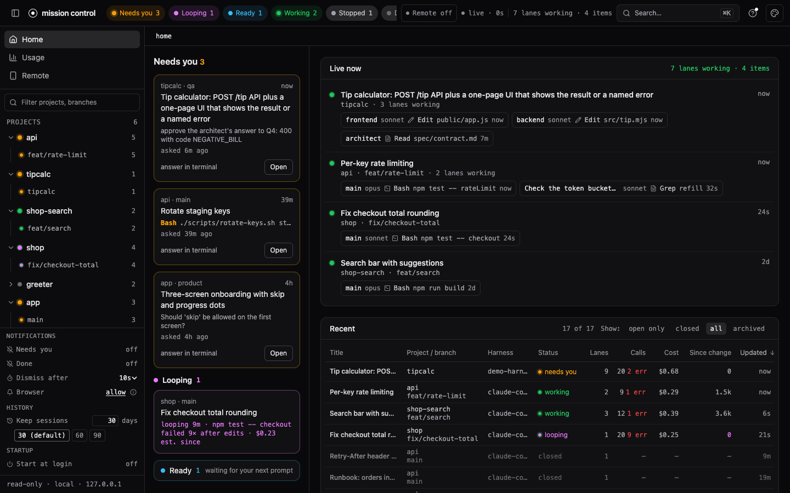
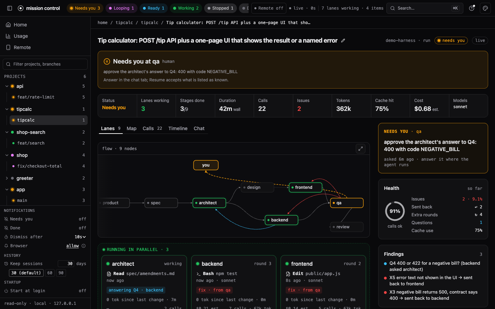
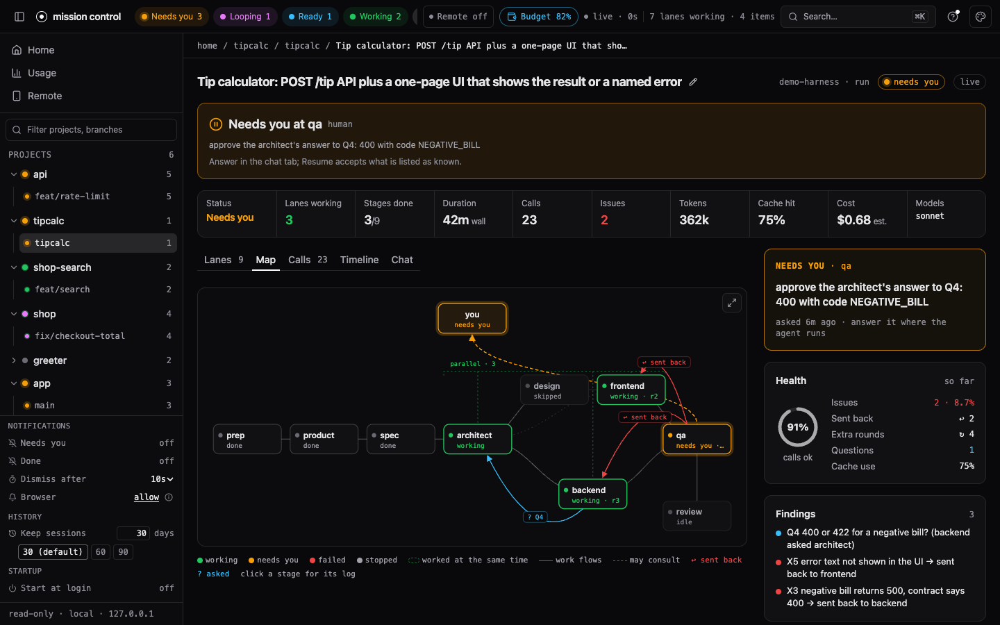
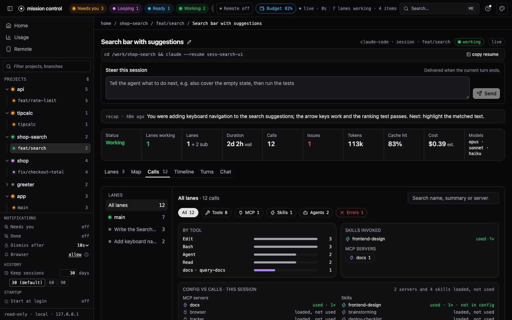
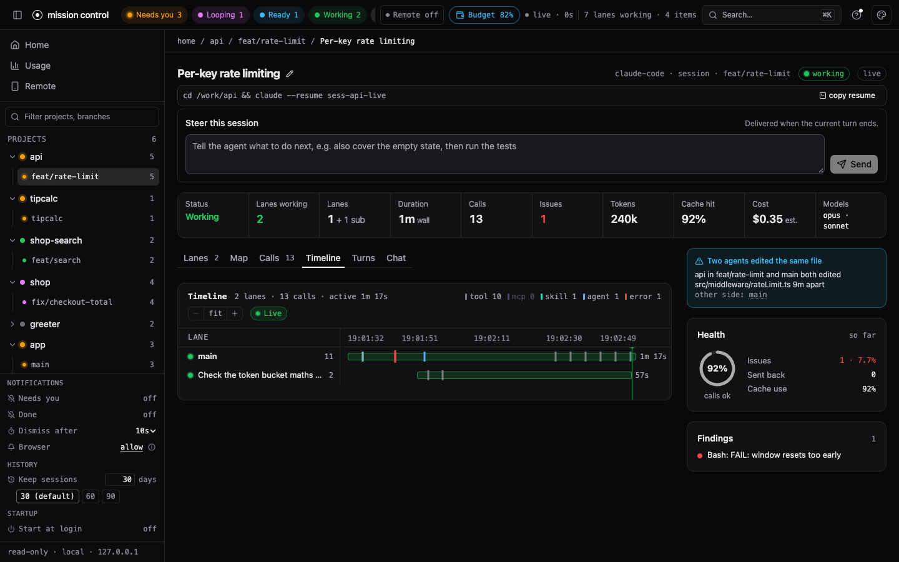
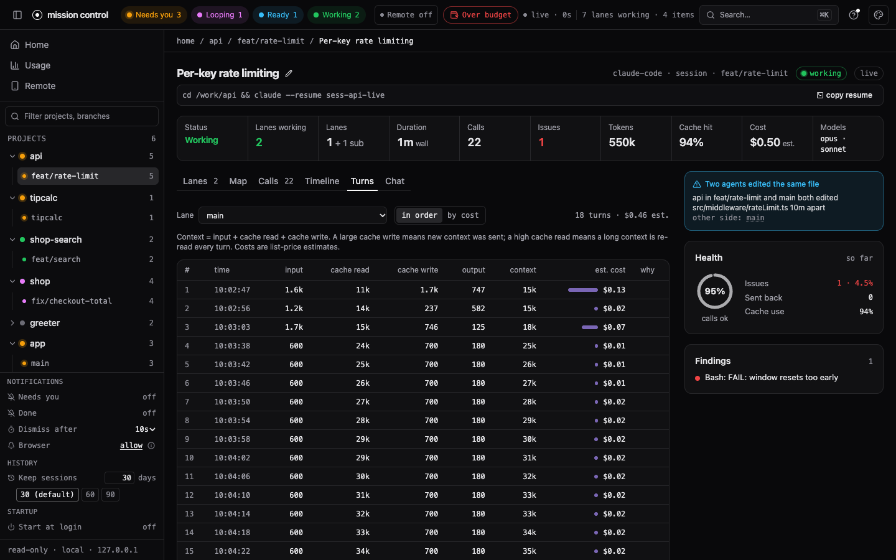
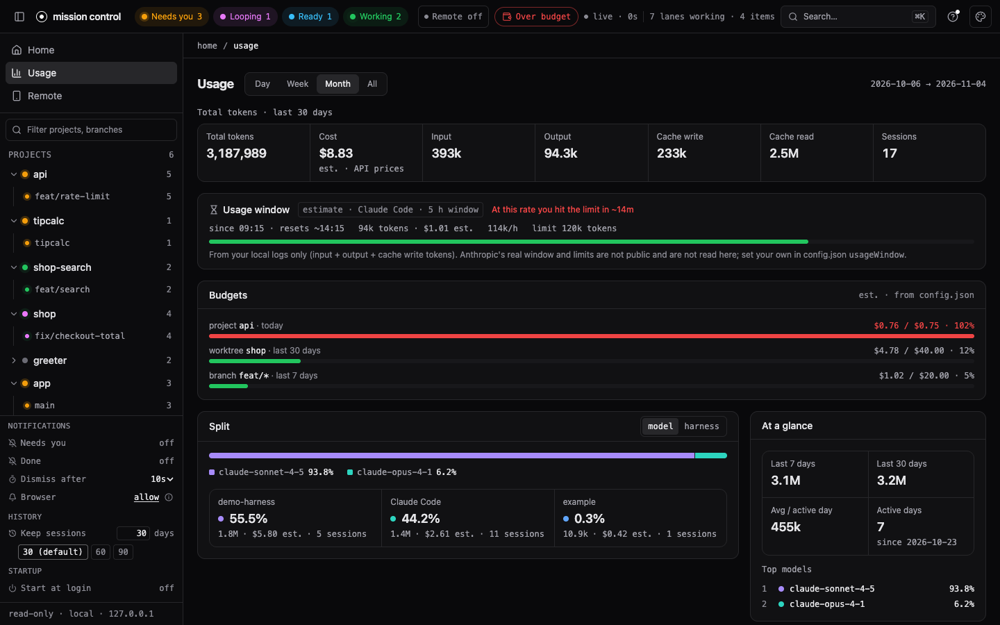
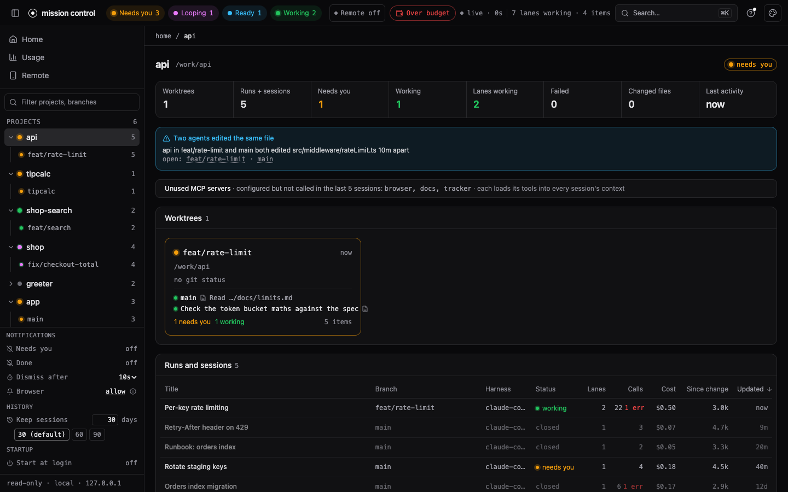

# mission-control

One local dashboard for all your AI coding work. It organises everything as **projects → worktrees → sessions and runs → lanes**: a project is a repository, a worktree is a checkout of it (a branch), a session or run is one piece of agent work, and a lane is one agent inside it (the main agent, a subagent, a harness stage, a crew member). A "Needs you" queue collects everything that is blocked on a human.

It reads Claude Code and Codex CLI sessions with no setup, and any other harness that writes a small run format or ships an adapter.

▶ [Watch the 60-second demo](https://ronincrew.dev/mission-control)



Zero runtime dependencies. Runtime: Node 20 or newer. Building the page and running the tests need Node 20.19 or newer. Local-first: no accounts, no cloud. Its only outbound connections are opt-in (`gh pr list`, and an empty notification ping to a paired phone).

## Quick start

You need Node 20 or newer (`node --version` prints it).

**Try it** (nothing to install):

```bash
npx @aldefy/mission-control
```

It prints `mission control on http://localhost:4319` and, on macOS, opens that page. Every Claude Code session under `~/.claude/projects` and every Codex session under `~/.codex/sessions` is already there, grouped by project and git worktree. Open one to see its lanes (the main agent and each subagent), calls, timeline, chat and usage. Stop it with Ctrl-C.

**Keep it** (needed for the hooks and the phone, because they point at the installed copy):

```bash
npm install -g @aldefy/mission-control
mission-control
```

### Needs you, and answering from your phone

The **Needs you** queue fills from Claude Code and Codex hooks. With [Tailscale](https://tailscale.com) on your laptop and phone, one command sets up the hooks and the phone together, asking before each change:

```bash
mission-control remote setup
```

It writes the hooks into `~/.claude/settings.json` (and `~/.codex/hooks.json`), keeping your other hooks and saving a backup, puts the phone page on your tailnet, and shows a QR code. Scan it, add the page to your Home Screen, and turn on notifications. A prompt that waits on you then buzzes your phone, and you can Allow, Deny or pick an option there. `mission-control remote doctor` shows anything still missing. Full guide: [docs/remote-answering.md](docs/remote-answering.md).

Only want the queue on the laptop, without Tailscale? `mission-control hooks install` (or `hooks install codex`) prints the hooks block to merge by hand: [docs/claude-code.md](docs/claude-code.md), [docs/codex.md](docs/codex.md). In Codex, run `/hooks` once to trust them.

Codex sessions are read from `~/.codex/sessions` whenever it exists; pass `--codex-dir <dir>` if your Codex home is elsewhere.

### From source

```bash
git clone https://github.com/aldefy/mission-control
cd mission-control
npm ci
npm run build
node bin/mission-control.mjs
```

Building needs Node 20.19 or newer.

### Check that it works

```bash
curl -s http://localhost:4319/api/sources
```

lists every source that is on (`claude-code`, `codex`, and any runs or adapters you passed), with the directory each one reads. `curl -s http://localhost:4319/api/items` lists what the home page shows. An empty list with the source present means the directory has no sessions yet: run one Claude Code or Codex session and reload.

### Common problems

| what you see | what to do |
|---|---|
| `npm ci` or `npm run build` fails on syntax or engine errors (from source) | Node is too old. Install Node 20.19 or newer and run both again. |
| The browser shows a 404 and the terminal says `no built page ... run npm run build` | From source only: the page was not built in this checkout. Run `npm run build`, then restart. |
| `EADDRINUSE` or "port in use" | Something already listens on 4319 (maybe another copy). Use `--port 4400`, or set `MISSION_CONTROL_PORT`. |
| No Claude Code sessions | Sessions live in `~/.claude/projects`. If yours are elsewhere, pass `--claude-dir <dir>`. |
| No Codex sessions | Codex turns on only when `$CODEX_HOME/sessions` (default `~/.codex/sessions`) exists. Pass `--codex-dir <dir>` to point at a sessions directory directly. |
| Needs you stays empty | Hooks are optional. Run `mission-control remote doctor` to see whether they are in; `mission-control remote setup` (or `hooks install`) adds them. After moving the install or upgrading Node, run it again: the hooks hold absolute paths. |
| Costs look wrong | They are API list-price estimates, not your bill. See [Costs are estimates](#costs-are-estimates). |

## Try it with demo data

```bash
npm run demo                      # synthetic projects, sessions and runs on http://localhost:4320
npm run demo -- --port 4400       # another port
npm run demo -- --live            # keep appending to the live session and the busy run
```

The demo generates invented data into `examples/claude`, `examples/hooks`, `examples/runs` and `examples/demo-home` (a stand-in home with configured MCP server and skill names, budgets and a usage window) and serves it; the generated files are git-ignored (one sample run, `examples/runs/20261101-0900-greeter`, is tracked). It defaults to port 4320 so it never clashes with a real dashboard on 4319. It never reads your own `~/.claude`, `~/.codex` or `~/.mission-control/config.json`.

## Flags

| flag | meaning |
|---|---|
| `--port <n>` | port to listen on (default 4319; or set `MISSION_CONTROL_PORT`) |
| `--no-open` | do not open a browser |
| `--claude-dir <dir>` | a Claude Code projects directory instead of `~/.claude/projects` |
| `--no-claude` | skip Claude Code |
| `--codex-dir <dir>` | a Codex sessions directory instead of `~/.codex/sessions` (turns Codex on) |
| `--no-codex` | skip Codex |
| `--runs <dir>` | a directory of runs in the [run format](FORMAT.md) |
| `--speckit <repo>` | a spec-kit-compound repository |
| `--adapter <file>` | your own adapter module; `--adapter-opt k=v` passes options to it (repeatable) |
| `--remote-port <n>` | turn remote answering on for this run, on `127.0.0.1:<n>` (needs `--remote-host`; must differ from `--port`). Overrides `remote.port`; never written to config. See [remote answering](docs/remote-answering.md) |
| `--remote-host <name>.ts.net` | the tailnet name the phone opens (needs `--remote-port`). Overrides `remote.host` |

Other commands: `hooks install` prints the Claude Code hooks block, `hooks install codex` the Codex one; `hook <Event>` and `hook codex` are what those hooks run. `remote setup` takes you from zero to a paired phone in one command (asking before each change) and `remote doctor` shows what is missing, `remote pair` prints a one-time pairing link and QR code, `remote devices` lists paired devices, `remote revoke <id>` removes one, and `remote on`, `remote off` and `remote status` turn remote answering on and off (see [remote answering](docs/remote-answering.md)).

## Levels: how much you set up

| level | what you do | what you get |
|---|---|---|
| 0 | nothing | Claude Code sessions under `~/.claude/projects` and Codex CLI sessions under `~/.codex/sessions` appear on their own: projects, worktrees, subagent lanes, calls, tokens, estimated cost, usage history |
| 1 | install the hooks | the **Needs you** queue and live status: a session that is asking for permission or approval shows up as waiting |
| 2 | write runs in the [run format](FORMAT.md) | any harness shows up as a run with stages as lanes, a timeline and a crew map |
| 3 | write an adapter | your own source: extra tabs, action buttons, anything the run format cannot say |

## Use with your own harness

If your agents are not Claude Code or Codex, you have two ways in, both covered step by step in [docs/own-harness.md](docs/own-harness.md):

- **Level 2, the run format.** Your harness writes two files per run, `state.json` (title and stages) and `runs.jsonl` (one event per line: stage start and end, LLM sessions with tokens, tool progress, issues, stops that wait on a human). Point the dashboard at the directory with `--runs /work/runs`. No code runs inside the dashboard. The full reference is [FORMAT.md](FORMAT.md).
- **Level 3, an adapter.** A JS module whose default export is `create(options)`, loaded with `--adapter /work/my-adapter.mjs`. It can return runs (a v1 adapter, wrapped for you) or items with lanes and calls (a v2 source), and it can add tabs and action buttons such as Sign and Answer.

The guide has a complete worked run, writer snippets in Node, Python and Bash, a minimal adapter file, and a checklist.

## The pages

**Home** lists what needs you, what is looping, what is ready for your next prompt (collapsed), what is live, and the latest work across every project. The top bar has a chip per state: **Needs you**, **Looping**, **Ready**, Working, Stopped, Done today; a click filters the sidebar and Home.

The page gets pushed updates: `GET /api/events` (Server-Sent Events) says "changed" the moment a hook line lands or a live session file grows, and the page refetches at once. Polling every 2 s stays as the fallback, and the freshness badge counts the stream's heartbeats. Browsers allow about 6 open HTTP/1.1 connections per origin, and each tab holds one for the stream: with more than ~5 dashboard tabs open on the same address, further tabs (and their fetches) queue until one closes. Keep one or two tabs open, or open extra ones on `127.0.0.1` as well as `localhost` (two origins).

## States

| state | meaning |
|---|---|
| needs you | a permission prompt or question is open (hooks); the card shows the tool, the command or path and how long ago it was asked, and flags a **new prompt** when it changes |
| looping | working, but retrying the same failure (below) |
| working | live: its files changed in the last two minutes |
| ready | done and waiting for your next prompt: Claude's idle reminder, or a Codex turn that ended in the last 30 minutes. Not urgent, so not in Needs you |
| stopped / failed / done / idle | as before |

## Looping

A session that silently retries a failing test is the expensive kind of stuck. A working lane is **looping** when one of these holds (`src/loops.mjs`):

1. the same tool and command fails 4 times in a row;
2. the same check (test, build, lint, typecheck) fails with the same first error line 4 times, with file edits in between;
3. 300k new tokens (input + output + cache write; cache reads never count) and 10 minutes since the last file change, with no passing check since and at least 3 failed calls or one failed check (test, build, lint...) in that stretch. Long read-only work with a stray failed Read is not a loop. Set `cost` to trip on estimated dollars since the change instead of (or as well as) tokens.

A failing test that then passes is not looping, and different commands failing are not looping. The lane card says how long, what failed how often and the estimated cost since ("looping 14m · npm test failed 9× · $3.20 est. since") and links to the first failing call. It works for Claude Code, Codex and harness runs (`progress` events with `tool`/`detail`, `issue`, `stage.end` with `ok: false`).

Every lane and item also shows **tokens since last file change**: new tokens (input, output and cache write) used since the last successful Edit, Write, MultiEdit or apply_patch (a failed edit does not reset it), the cache reads in that stretch apart, and how long ago that was ("41k tok (+3.1M cached) since last change · 18m"). Cache reads are shown but not counted: on a large context they grow by the whole context every turn and say little about work done. It is a sortable "Since change" column in the Home and project tables.

The thresholds live in `~/.mission-control/config.json` (re-read when it changes):

```json
{ "loops": { "repeat": 4, "cycles": 4, "minutes": 10, "tokens": 300000, "cost": 0 } }
```

**Run / session page** has tabs. Lanes shows one card per agent with what it is doing now. Map draws the crew and how work flowed between lanes.





**Calls** lists every tool, MCP, skill and subagent call, filterable by lane and kind and searchable, with arguments and results. Under the breakdown, "Config vs calls" lists each MCP server and skill you have configured as used, loaded but not used, or failing (half or more of its calls errored), plus anything called that is not in the config.



**Timeline** is a waterfall of lanes, LLM calls and tool calls over time, with the slowest span marked.



**Turns** (Claude Code and Codex sessions) lists each assistant turn with its input, cache read, cache write and output tokens, context size and estimated cost, in order or most expensive first. A marker shows where the context dropped sharply (a compaction), and a short hint says why a turn was expensive: a large cache write means new context was sent, a high cache read means a long context is re-read every turn.



**Chat** shows a session's conversation one lane at a time, with tool calls as chips.

**Usage** shows tokens and estimated cost by day, week or month, split by model or harness, with an activity heatmap and breakdowns by project, worktree, branch and pull request. It also shows your [budgets](#budgets) and a [usage-window estimate](#usage-window-estimate).



**Project** shows a project's worktrees with live lanes and its runs and sessions. When two sessions or runs of the project (in any worktrees) changed the same repo-relative file within 30 minutes, a warning names both ("api in feat/rate-limit and main both edited src/middleware/rateLimit.ts 8m apart"); the same warning sits on both items' rails. A note lists configured MCP servers that none of the last 20 sessions called.



All screenshots come from the synthetic demo data.

## Costs are estimates

Costs are API list-price estimates computed from token counts (input, output, cache write, cache read) and the model, and the page marks them "est.". For Claude models the price goes by family and version (for example Opus 4/4.1 at $15/$75 per million tokens, Opus 4.5 and later at $5/$25). For OpenAI models used by Codex only exact model ids in the table are priced (for example `gpt-5` at $1.25/$10 with cached input at $0.125); a model id the table does not list, including a newer version, costs nothing and shows as "–" (no price). They are not your bill: plans, subscriptions (a ChatGPT or Claude plan) and discounts differ, and list prices change. Both tables are dated and live in `src/sources/claude-code/prices.mjs`; edit them when they go stale.

## Settings: config.json

`~/.mission-control/config.json` holds every setting; all keys are optional and the file is re-read when it changes. A missing or broken file means defaults.

```json
{
  "hide": ["/work/scratch", "project-name"],
  "budgets": [
    { "scope": "project", "match": "api", "daily": 5 },
    { "scope": "branch", "match": "feat/*", "weekly": 40 },
    { "scope": "worktree", "match": "shop-search", "monthly": 120 }
  ],
  "usageWindow": { "hours": 5, "limitTokens": 2000000, "limitUsd": 30 },
  "remote": { "enabled": false, "host": "laptop.tail1234.ts.net", "port": 4330, "waitSeconds": 120 }
}
```

`remote` configures [remote answering](docs/remote-answering.md): off by default, port 4330, and hooks wait up to `waitSeconds` (10–600, default 120) for a phone answer. `--remote-host` and `--remote-port` override `host` and `port` for one run.

### Budgets

Each budget has a `scope` (`project`, `worktree` or `branch`), a `match` (a project name or path, a worktree path or folder name, or a branch; a trailing `*` matches a prefix) and one or more of `daily`, `weekly`, `monthly` in US dollars. Periods are rolling: today, the last 7 days and the last 30 days. The Usage page draws a bar per budget, and the top bar shows a chip at 80% ("Budget 83%") and at 100% ("Over budget"). Spend is the same list-price estimate as everywhere else.

### Cost per pull request

The Usage breakdown's "Pull requests" tab maps branches to pull requests with the GitHub CLI (`gh pr list --json headRefName,number,title,state`, read-only, run in the project's folder, cached for 10 minutes). It is optional: without `gh`, or when it is not logged in, the tab says so and nothing else changes.

### Usage-window estimate

For Claude Code, the Usage page estimates the current rolling usage window from your local logs: a window opens at your first activity after the previous one ended and lasts `usageWindow.hours` (default 5). With a limit you set yourself (`limitTokens`, counting input + output + cache write tokens, and/or `limitUsd`), it says "At this rate you hit the limit in ~1h 40m"; without one it says "No limit set". It is always labelled an estimate: Anthropic's actual windows and limits are not public and are not read or claimed here.

## Hiding projects

Tool-internal projects (for example an observer's data directory) are hidden by default. To hide more, create `~/.mission-control/config.json`:

```json
{ "hide": ["/work/scratch", "project-name"] }
```

Each entry is a project path or name. The file is re-read when it changes. Hidden projects stay reachable from a filter toggle in the sidebar.

## Security

Local only, no accounts, no cloud. There are two listeners.

**The dashboard, `:4319`.** It binds `127.0.0.1` and `::1` and:

- answers only requests whose `Host` is `localhost`, `127.0.0.1` or `[::1]` on its own port (anything else gets 403), so a web page cannot reach it through DNS rebinding;
- takes a POST only with `content-type: application/json` (else 415) and, when the browser sends an `Origin`, only from `http://localhost:<port>`, `http://127.0.0.1:<port>` or `http://[::1]:<port>` (else 403), so another site cannot submit to the action routes.

Besides the action routes, it has these write routes, all behind the two guards above:

- `POST /api/item/:source/:id/title` (`{ "title": string }`, empty restores the source's title) and `POST /api/item/:source/:id/mark` (`{ "pinned"?: boolean, "archived"?: boolean }`). They write only the dashboard's own `~/.mission-control/titles.json` and `marks.json` (under `MISSION_CONTROL_HOME` when set); Claude Code's and Codex's files stay read-only. An unknown item is 404, a bad body 400.

For remote answering there is exactly one write route, `POST /api/remote/enabled`, behind the Remote answering switch. Its guards, in order: the loopback bind; the `Host` check above (403); a **required** `Origin` equal to `http://<the request's Host>` (missing or foreign: 403); `content-type: application/json` (else 415); a body of exactly `{"enabled": true|false}` (else 400). It can only turn remote answering on or off. `GET /api/remote/status` is read-only and never returns a token, secret or hash. No pairing, answering, device or revoke route exists on `:4319`.

**Remote answering, off by default.** When you turn it on (`--remote-port` with `--remote-host`, `mission-control remote on`, or the switch), a second listener opens on `127.0.0.1` only (default port 4330). It is meant to sit behind `tailscale serve --bg --https=443 http://127.0.0.1:4330`, which puts it on your tailnet over HTTPS at `https://<name>.ts.net`. It:

- answers only `Host` `<name>.ts.net` or `<name>.ts.net:443` (else 403), and only `Origin` `https://<name>.ts.net` (a foreign Origin, or a POST without one, gets 403); a non-JSON POST gets 415;
- serves only the phone page (`/`, `/pair`, the manifest, the service worker, icons and assets), `/api/remote/{pair,me,prompts,events,answer}` and `/api/remote/push/{key,subscribe,unsubscribe}`. Everything else is 404, including every dashboard API: no transcripts, calls or usage;
- needs a paired device for every route but `pair`.

**Never use `tailscale funnel` for this.** Funnel puts the page on the public internet. It is also never bound to your LAN: plain HTTP over the LAN is not supported.

**Pairing and devices.** Pairing and revoke are CLI-only. `mission-control remote pair` makes a one-time token (32 random bytes) that expires after 10 minutes and works once. Only its SHA-256 is stored. It travels in the URL fragment (`/pair#t=…`), so it never reaches a log. Redeeming it creates a device and sets a `__Host-mc_device` cookie (`Secure`, `HttpOnly`, `SameSite=Strict`, `Path=/`, one year) holding the device id and a random secret. Only the secret's SHA-256 is stored, and it is compared in constant time. After 10 failed pairing attempts in a minute, further attempts get 429. `mission-control remote revoke <id>` takes effect on that device's next request. A copied cookie works until you revoke it, so revoke a lost phone.

**What a phone can do.** Allow once or deny a Claude Code or Codex permission prompt, or pick one listed option of a Claude Code AskUserQuestion. Never "always allow", never a permission rule, never free text, plan approval or a new prompt. Each answer is bound to the prompt id plus a hash of the tool, target and options it showed, so a prompt that was replaced, answered in the terminal or timed out is refused (409) and nothing reaches the session.

**The hook wait, and fail-open.** The `PermissionRequest` hook (and Claude's `PreToolUse` for AskUserQuestion) holds the request for a phone answer only while the server is running (heartbeat under 6 s), remote answering is on and at least one device is paired. It waits at most `remote.waitSeconds` (default 120). On a timeout, the server stopping, remote being turned off, the prompt being answered in the terminal, or any error, it prints nothing and exits 0, so the terminal prompt handles the request exactly as without Mission Control. It never uses `onFailure: "block"`. The hook and the server talk only through files under `~/.mission-control/remote/` (directory 0700, files 0600); the hook opens no socket.

**Notifications, opt-in per phone.** A phone sends nothing until you tap "Turn on notifications" in the app (on iOS, from the Home Screen app). Then, when a new prompt starts waiting, the server sends that device one Web Push ping with **no payload**, signed with a VAPID key pair kept in `~/.mission-control/remote/vapid.json` (0600). The push service (Apple, Google or Mozilla) learns only that something is waiting. The app then fetches the prompt from this server over your tailnet to show it. Only `https` endpoints of those push services are accepted. A subscription belongs to one device: it goes when you revoke the device, turn notifications off, or the push service says it is gone. This is the only connection Mission Control opens to the internet on its own.

**`remote setup` and your settings.** `mission-control remote setup` merges Mission Control's hooks into `~/.claude/settings.json` (and `~/.codex/hooks.json` when `~/.codex` exists) only after you answer `y` (or with `--yes`). It keeps every other hook, replaces only earlier Mission Control entries, and saves a timestamped backup next to the file first. A file that is not valid JSON is never overwritten. `remote doctor` only reads.

**Codex hooks are a guardrail, not a complete enforcement boundary.** Codex documents its hooks that way. A phone answer is one way to answer a Codex approval, not a control over what Codex may do.

**Audit log.** Every accepted phone answer appends one line to `~/.mission-control/audit.jsonl` (mode 0600, append-only): time, device id, prompt id, `allow`, `deny` or `answer`, the tool, and a SHA-256 of the masked target (or of the question texts). Every actual on/off change appends `{ts, actor, action}`. No command, path, question, option or secret is written there.

The built-in sources are read-only: they never write to a runs directory, a repo, `~/.claude` or `~/.codex`. The only things written are the hook logs under `~/.mission-control/hooks`, a usage cache under `~/.mission-control/cache`, the remote-answering state under `~/.mission-control/remote`, `remote.enabled` and `remote.host` in `config.json` when you turn remote answering on or off or run `remote setup`, `~/.mission-control/audit.jsonl`, and, only when you agree to it in `remote setup`, the hook entries in `~/.claude/settings.json` and `~/.codex/hooks.json`.

The config readers behind "Config vs calls" read names only: MCP server names from `~/.claude.json` (`mcpServers`, and the project entry's `mcpServers` minus `disabledMcpServers`), a project's `.mcp.json`, enabled plugin names from `~/.claude/settings.json` and the project's `.claude/settings.json` / `settings.local.json`, skill folder names under `~/.claude/skills` and the project's `.claude/skills`, and `[mcp_servers.<name>]` table names from `$CODEX_HOME/config.toml`. Commands, arguments, URLs, environment variables, headers and tokens in those files are never returned, stored or logged. The only command the server runs besides read-only `git` is the optional read-only `gh pr list` above. It and the opt-in notification ping are the only things that may reach the network. Session names are confined to their root, so `..` and symlinks out of it are refused. The pages make no network requests outside their own server: they use system fonts and load nothing from elsewhere.

## Develop

```bash
npm ci
npm run build       # builds the React app into dist/
npm test            # node tests + vitest
npm run typecheck
npm run dev         # vite dev server for the page
```

## License

MIT
